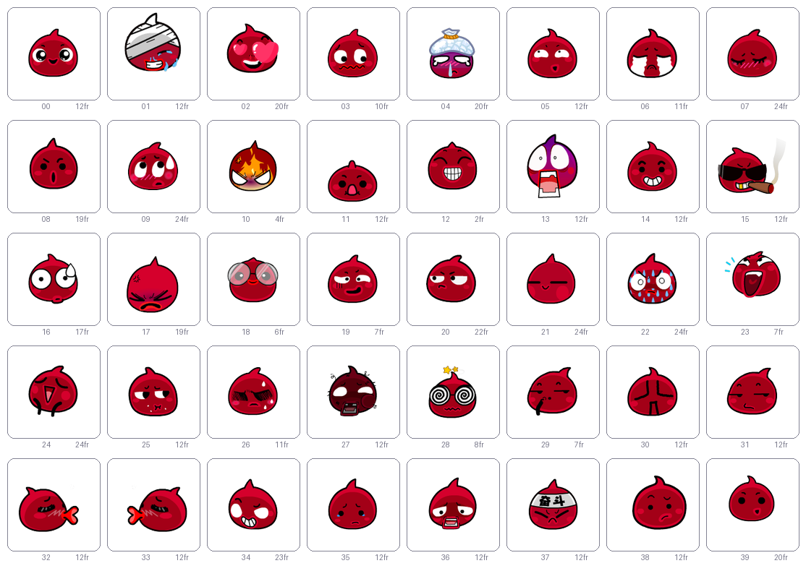
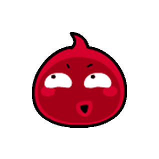
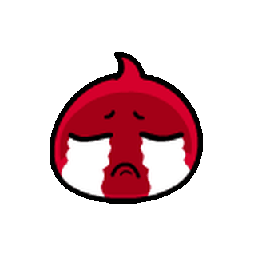
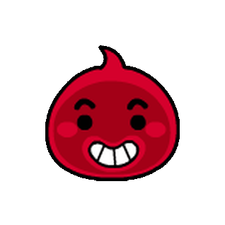

# 表情包 · 40 个动图

40 个表情动图：**557 帧，40 个表情，三种格式，318×318，真 alpha 通道**。

帧序、每帧停留时长和循环长度都已逐帧对齐，打开就是完整循环。



## 内容

| 路径 | 说明 |
|---|---|
| `emotes_final/gif/` | 40 个 GIF —— 兼容性最好，微信 / QQ / Discord 直接发 |
| `emotes_final/webp/` | 40 个动图 WebP —— 无损，保留半透明 |
| `emotes_final/apng/` | 40 个 APNG —— 无损，保留半透明 |
| `emotes_final/manifest.json` | 每个表情的帧序、每帧时长、源图矩形、摆放坐标、循环长度 |
| `emotes_final/总览.html` | 总览页，浏览器直接打开 |
| `emotes_final/预览.png` | 40 个表情的联系表 |
| `build/` | 生成与校验脚本，用法见 [`build/README.md`](build/README.md)（源图不在仓库） |

## 预览

<table>
<tr>
<td align="center"><br><sub>00</sub></td>
<td align="center"><br><sub>01</sub></td>
<td align="center"><br><sub>02</sub></td>
<td align="center"><br><sub>03</sub></td>
<td align="center"><br><sub>04</sub></td>
<td align="center"><br><sub>05</sub></td>
<td align="center"><br><sub>06</sub></td>
<td align="center"><br><sub>07</sub></td>
</tr>
<tr>
<td align="center"><br><sub>08</sub></td>
<td align="center"><br><sub>09</sub></td>
<td align="center"><br><sub>10</sub></td>
<td align="center"><br><sub>11</sub></td>
<td align="center"><br><sub>12</sub></td>
<td align="center"><br><sub>13</sub></td>
<td align="center"><br><sub>14</sub></td>
<td align="center"><br><sub>15</sub></td>
</tr>
</table>

全部 40 个见 [`emotes_final/总览.html`](emotes_final/总览.html)。

## 规格

| 项目 | 值 |
|---|---|
| 表情数 | 40（`emote_00` – `emote_39`） |
| 总帧数 | 557 |
| 画布 | 318 × 318（统一，主体居中） |
| 主体典型尺寸 | 170 px |
| 单帧时长 | 约 11–23 fps，每帧 2–12 个步进 |
| 透明 | 四种格式都是真 alpha；GIF 受格式限制只有二值透明 |

一个表情一个循环，循环长度按每帧步进算出。

## 怎么重新生成

仓库只提供成品动图，生成用的源图不在仓库里。要重渲一遍，先把 40 张源图按 `emotion_00.png` – `emotion_39.png` 放进 `build/data/atlas/`，然后：

依赖只有 `Pillow` 和 `numpy`：

```bash
pip install pillow numpy
```

```bash
cd build
python render_final.py        # 重新生成 emotes_final/，约 10 分钟
```

`render_final.py` 会先清空 `../emotes_final/`，再从 `data/` 读源图和测量数据重建 GIF / WebP / APNG / 逐帧 PNG，并写出 `manifest.json`、`总览.html`、`预览.png`、`frames/`、`original/`。

三道门禁（结构、三格式解码与朝向、无底色）在 `build/check/`：

```bash
cd build/check
python _verify_all.py
python _gate2.py
python _alphagate.py
```

门禁要读 `data/atlas/` 的源图和重新生成的 `emotes_final/frames/`，所以得先放好源图、跑过 `render_final.py`。

**想改某个表情的大小**：编辑 `build/render_final.py` 顶部的 `SIZE_ADJUST`，一行一个，改完重跑即可，其他 39 个不受影响：

```python
SIZE_ADJUST = {
    1: 1.15, 13: 1.15, 15: 1.15, 17: 1.15, 32: 1.15, 33: 1.15,   # 偏小
    38: 0.87, 39: 0.87,                                          # 偏大
}
```

`OUT_TYPICAL`（默认 170）是整体大小，`OUT_CANVAS`（默认 318）是所有文件共用的正方形边长。

## 这个版本的关键决定

1. **大小**：用「主体墨迹面积 3 : 主体长度 1」的混合做归一，再叠加 `SIZE_ADJUST` 手工标定。之所以要手工标定，是因为 01/13/15/17/32/33 与 38/39 的判断在任何单一度量下都自相矛盾（e15 与 e38 在所有可计算量上几乎相同，却被判成相反方向）。详见 [`build/README.md`](build/README.md)。

2. **画布**：40 个文件一律 318×318，主体居中，看图软件按文件像素显示时不会再出现「有的看起来大有的看起来小」。

3. **位置**：每帧的位置和朝向都已逐帧对齐。唯一例外是 39 的 4 帧（cell 12–15），原素材中没有出现，位置按播放顺序取最近帧补的。

4. **帧数**：557 帧，帧序与时长均已对齐。

## 已知限制

- **GIF 的半透明**：GIF 只有二值透明，烟、泪水这类半透明像素在 GIF 里被量化掉，所以个别表情（如 15）在 GIF 中看起来比 APNG/WebP 略窄。要完全一致请用 APNG 或 WebP。
- **e11 的垂直位置**是按跳跃弧补的，不是直接测得的；这是唯一一个位置靠推断的表情。
- **e39 的 cell 12–15** 在原素材中未出现，位置为推断，时长取邻近帧。

## 版权与免责

- **表情美术资源**版权归原作者所有。本仓库不做任何授权，仅供个人学习、交流与存档使用，请勿用于商业用途；权利人如提出要求，会立即删除。
- **`build/` 下的代码**以 MIT 许可证发布，见 [LICENSE](LICENSE)。该许可证只覆盖代码，不覆盖任何美术资源。

## English

A pack of 40 animated emotes: 557 frames, 318×318 canvas, true alpha, exported as GIF, lossless WebP and APNG. Each emote loops seamlessly; frame order, per-frame duration and loop length are aligned frame by frame. `build/` contains everything needed to regenerate the pack (`python render_final.py`).

The artwork remains the property of its original author and is included for personal study and archival purposes only, with no license granted. The build scripts are MIT licensed.
